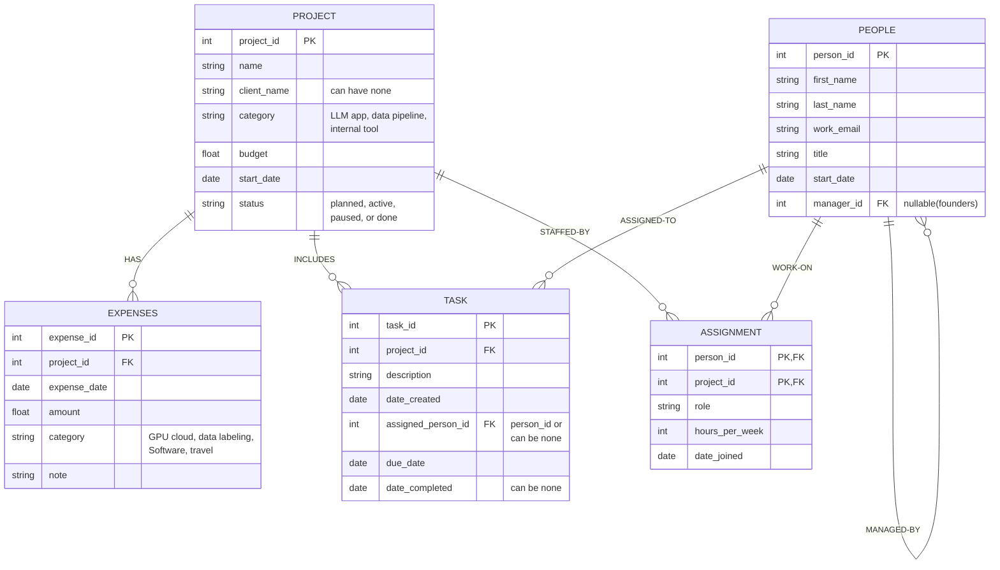

**Part A - The README**

1. **The Scenario:**
       
       I chose scenario A - BabsonAI Labs. I liked this choice as it could have many uses for different business owners or managers that want to keep track of projects. Or if I want to keep track of personal projects in the future. 

2. **The ERD:**

3. **What One Row Means:**

        The ERD diagram that I created has 5 tables:

        1. The Project table is a table that keeps a record of one specific project where 1 line represents 1 project that the company is running. 
        
        2. The Expense table is information about the expenses, or transaction,related to a project where each row represents a single recorded expense for a single project, with some aditional information. 

        3. The Person table keeps a record of the people who work there where every row represents 1 single employee in the firm, with information about each person, and if they are the manager(can be null).

        4. A single line in the Task table represents 1 single task, or a to do item, done by one single person in the company, and some additional information about the type, date, etc. There can only be 1 person per task. 

        5. The Assignment table keeps a record of which person is assigned to which project, so one row in assignment represents one specific pairing of a person to a project. If a person is working on 2 projects, that would be 2 entries. 

4. **Design Choice:**

        Which key I chose where the business already had one and why:

             I chose to create a key for the persons table, in person_ID, because although we could go off of their name or work email, those variables can change so it is better to use an arbitrary number that will not change. That goes the same for the project_ID, Task_ID, Expense_ID, it just makes it more robust incase any names or variables change after the fact. 

        
        Which relationships are optional:

            The first optional relationship is client_name in PROJECTS because inernal projects dont have a client, so that can be null. Another optional relationship is the manager_ID in PEOPLE table because a person does not need to be a manager, and the table can be self relient because someone can be someone elses superior, but does not have to be, because the two founders report to nobody. Assigned_person_ID can be null as well since the project doesn't have to be assigned to anyone yet and same with date completed because the project may not be completed yet. 

        Which of the scenario's rules can my tables not hold, and how will I check it instead:

                The tables cannot enforce the last rule where a task is only assigned to someone who works on its project and not before that persons start date, because checking this would mean comparing the task against a different table (assignment and people) and the standard check can only look at columns within a single table, and it also can handle the "never before that persons start date" part because it doesn't know which start date to refer to and its a date comparison accross multiple tables. I would fix or check for this when I write the code, where i would put the check in the part of the code that saves the tasks, or i could put it in the database itself where it runs a check before updating the table. 

        And one thing my agent proposed for the design that I changed or did not take:

                I mostly did all of the ERD design myself, where I drew it on paper first and then compared it to the one we did in class to write the code to make the ERD diagram. One thing the agent helped with with, however, is understanding the relationships between tables, and understanding why one of the rules may not work with this table. Another change that it added was the assignment table, I had the other 4 tables on paper, but the agent added the assignment table, which I kept. 